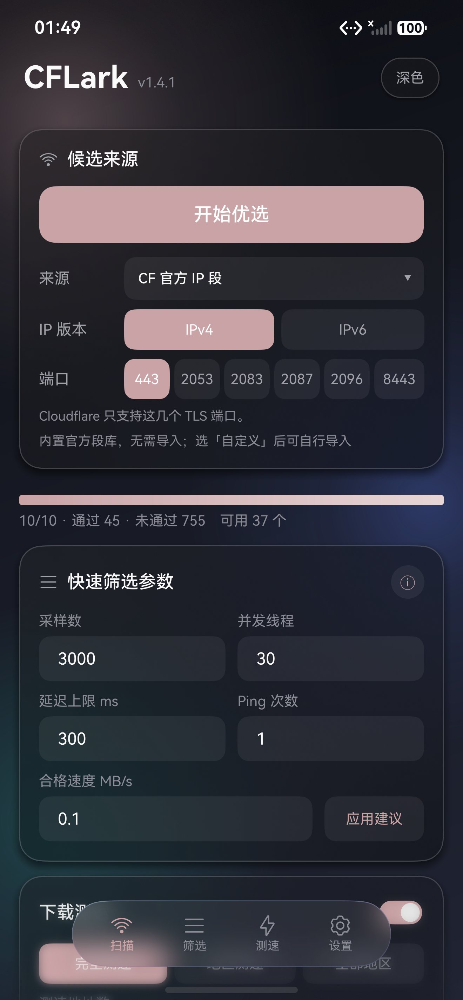
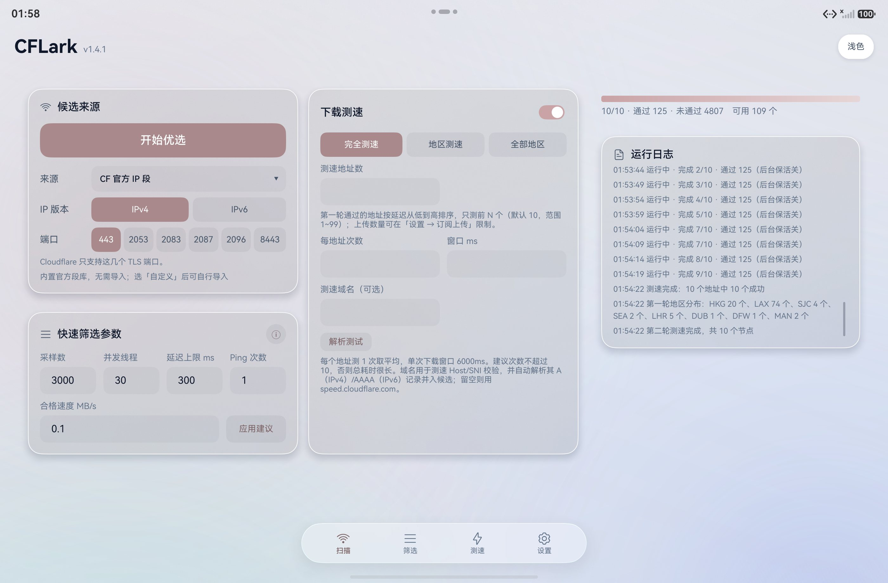
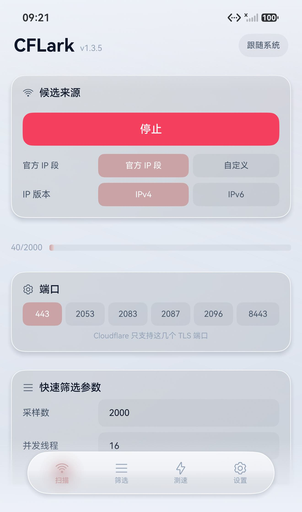
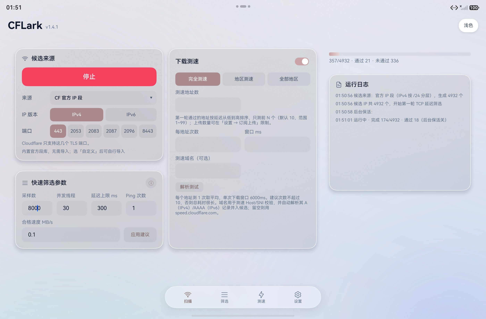
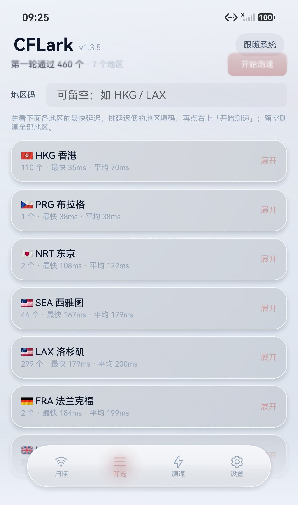
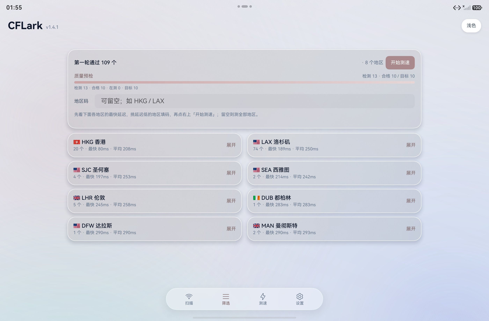
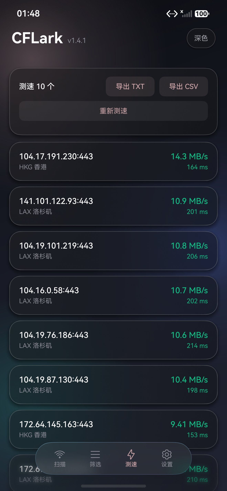
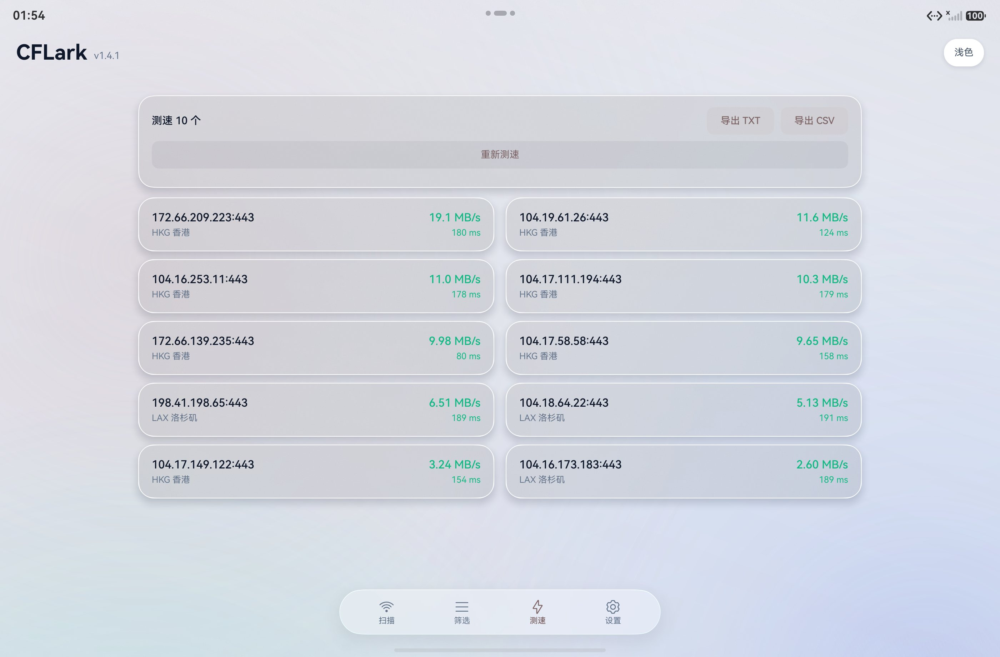
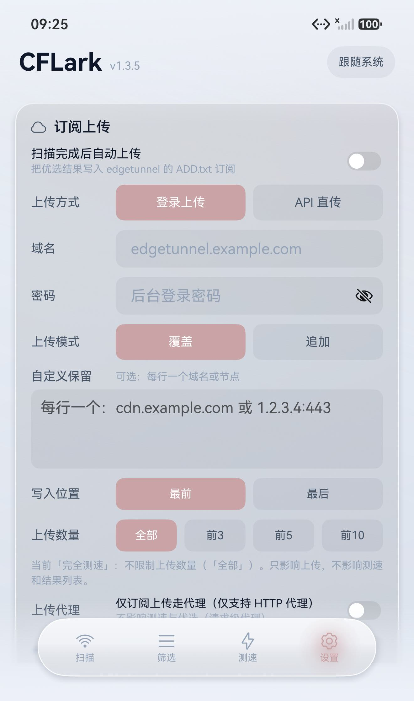
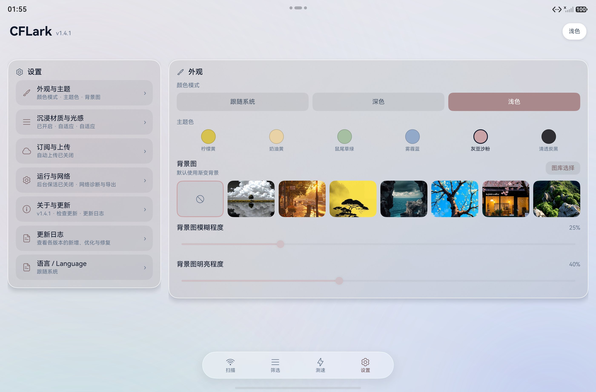

# CFLark · 鸿蒙 Cloudflare 节点优选

CFLark 是一款为 HarmonyOS NEXT 打造的原生 Cloudflare 节点优选工具。它会自动扫描 Cloudflare 官方 IP 段，经过 **TCP 延迟筛选 → 数据中心识别 → 下载测速 → 加权排序**，帮你在当前网络下找到更快、更稳的 Cloudflare 节点；支持域名端到端校验，并可把优选结果一键写入 edgetunnel 的 `ADD.txt` 订阅。

应用完全使用 ArkTS + ArkUI 原生实现，手机、平板、2-in-1 自适应布局，支持浅色/深色主题与系统沉浸材质。

## 功能特性

- **官方 IP 段扫描**：内置 Cloudflare IPv4 / IPv6 官方网段，支持“官方 IP 段”与“自定义 IP”两种候选来源。
- **三阶段优选流水线**：TCP 延迟筛选（并发可调、取多次最小值）→ 数据中心（colo）识别 → 下载速度测试，全程可取消、实时进度与日志。
- **地区化筛选**：按 HKG / LAX / NRT / SIN 等地区分组展示，可指定地区码后测速，也可“每地区各取最优”批量测速。
- **加权排序**：延迟与速度分别归一化后加权评分，支持完全测速 / 地区测速 / 全部地区三种模式。
- **域名端到端校验**：可指定域名作为 Host/SNI 参与测速，验证“IP + 域名”组合是否真正可用。
- **结果导出**：一键导出 TXT / CSV，方便粘贴到客户端或订阅配置。
- **edgetunnel 订阅上传**：支持“登录上传”（域名 + 后台密码）与“API 直传”（Cloudflare API Token 直写 KV）两种方式，覆盖/追加可选，支持自定义保留行与写入位置，自动连续编号。
- **参数持久化**：采样数、并发、延迟上限、测速参数等全部自动保存，下次打开无需重填；IPv4/IPv6 各有推荐默认值并可一键套用。
- **沉浸式 UI**：玻璃卡片、悬浮导航、浅色/深色主题、主题色与自定义背景图，支持跟随系统材质等级。

## 应用截图

> 手机与平板截图一一对应，共 10 张。

| 手机 | 平板 |
| --- | --- |
| <br><sub>扫描 · 候选来源 / 端口 / 快速筛选</sub> | <br><sub>扫描 · 平板三栏布局与运行日志</sub> |
| <br><sub>扫描进行中 · 实时进度</sub> | <br><sub>扫描进行中 · 进度与日志</sub> |
| <br><sub>地区筛选 · 按地区分组</sub> | <br><sub>地区筛选 · 平板双列展示</sub> |
| <br><sub>下载测速 · 结果与导出</sub> | <br><sub>下载测速 · 平板结果列表</sub> |
| <br><sub>设置 · 订阅上传</sub> | <br><sub>设置 · 订阅上传 / 外观 / 材质</sub> |

## 安装

### 方式一：HAP 安装（推荐）

1. 下载 Releases 中的 `CFLark-Harmony-1.3.6-release.hap`。
2. 连接鸿蒙设备（需开启开发者模式与 USB 调试），执行：

```bash
hdc install CFLark-Harmony-1.3.6-release.hap
```

3. 也可以把 HAP 传到手机/平板后用文件管理器打开安装（需允许安装未知来源应用）。

### 方式二：App Pack 发布包

下载 `CFLark-Harmony-1.3.6-release.app.hap`，将后缀 `.hap` 改为 `.app` 后，即可用于归档或上架流程。

> 安装包已使用调试证书签名，适用于个人设备安装测试。

## 使用流程

1. **扫描**：选择 IP 版本（IPv4 / IPv6）、端口与采样数，点击「开始优选」。
2. **筛选**：查看各地区通过 TCP 筛选的节点数量与最快/平均延迟。
3. **测速**：选择测速地址数后开始测速，得到下载速度与最终排名。
4. **导出/上传**：导出 TXT/CSV，或在「设置 → 订阅上传」中配置 edgetunnel 自动上传。

### 参数默认值与建议

| 参数 | IPv4 默认/建议 | IPv6 建议 |
| --- | --- | --- |
| 采样数 | 2000 | 3000~5000（随机地址命中率低） |
| 延迟上限 | 220 ms | 1500 ms（可达地址 RTT 常在 1000 ms+） |
| Ping 超时 | 1000 ms | 自动使用 3000 ms |
| 并发线程 | 16（上限 200） | 16 |
| 测速地址数 | 3 | 3 |

在扫描页点击“应用建议”可一键套用当前 IP 版本的推荐参数。

### 订阅上传（edgetunnel）

- **登录上传**：填写 edgetunnel 后台域名与密码，App 通过登录接口写入 `/admin/ADD.txt`。
- **API 直传**：填写 Cloudflare Account ID、Workers KV 命名空间 ID 与 API Token（需 Workers KV 读写权限），直接读写 KV 中的 `ADD.txt`，不依赖域名可达性。
- 支持「覆盖 / 追加」与「每地区上传数量」限制，追加时自动保留远程已有节点并继续编号。

## 从源码构建

环境要求：DevEco Studio 6.x（HarmonyOS SDK API 26）、Node.js 18+、ohpm、hvigor。

```bash
# 1. 安装依赖
ohpm install

# 2. 用 DevEco Studio 打开工程，或在工程根目录构建
hvigor assembleHap --mode module -p product=default

# 3. 命令行（若已安装 devecocli）
devecocli build --build-mode release
```

> 工程内的 `AppScope/app.json5` 已包含版本号；构建产物位于 `entry/build/default/outputs/default/`。

## 隐私与安全

- 应用不收集、不上传任何用户数据到第三方服务器；所有扫描与测速请求均由本机直连 Cloudflare 完成。
- 订阅上传所需的域名、密码、API Token 仅保存在本机 Preferences 中，不会发送到除 edgetunnel 服务端 / Cloudflare API 之外的任何地方。
- 源码中不包含任何签名证书、私钥、Token 等敏感文件；`.gitignore` 已排除证书与本地配置。

## 免责声明

本应用仅供学习与个人研究使用，与 Cloudflare 官方无关。请遵守所在地区法律法规及 Cloudflare 服务条款；因使用本应用（含节点测速、订阅上传等）产生的任何后果由使用者自行承担。

## 版本记录

### v1.3.6
- 扫描参数支持持久化保存，下次打开无需重填。
- 新增参数建议值提示与“应用建议”一键套用；IPv4/IPv6 分别给出默认建议。
- 修复输入框在切换协议或应用建议后不刷新的问题。
- 新增“网络诊断”自检（默认网络信息、固定/近邻/随机地址连通性），阶段一失败分类统计更清晰（IPv6 相关问题仍在验证中，不影响优选逻辑）。

### v1.3.5
- 优化悬浮导航交互：仅拖动时显示跟手光效与回弹，轻点不再触发扫光。
- 优化顶部/底部内容边缘的渐隐虚化过渡。
- 若干稳定性与细节改进。

### v1.3.4
- 关于页新增「GitHub 项目主页」「下载最新版本」入口。
- 新增免责声明。

## 许可证

本仓库仅用于学习交流。使用、修改与分发请自行评估风险并遵守相关法律法规。
